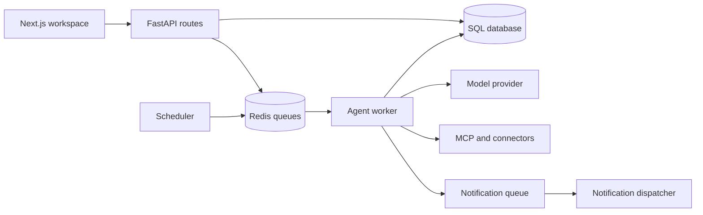

<div align="center">

# Relay · Agent Platform

**Configure agents, connect tools, and follow each run from one workspace.**

Next.js · TypeScript · FastAPI · SQLAlchemy · Redis

[Quick start](#quick-start) · [Architecture](#architecture) · [Backend guide](backend/README.md) · [Request flow](backend/docs/FLOW.md)

</div>

## The problem this addresses

An agent is more than a prompt: it needs credentials, tool permissions, a schedule, execution history, and a way to report its result. Relay brings those pieces into a single application for developers exploring how to operate agent workflows.

## What is included

- Agent configuration, a conversational builder, and run history.
- Connections for services such as Gmail, Slack, Sheets, YouTube, and HTTP tools.
- MCP server configuration and tool discovery.
- Scheduled runs, worker execution, and notification dispatch.
- Team conversations with a lead agent and shared task context.
- Optional Jenkins lifecycle hooks and a text-only, synchronous A2A interface.

## Quick start

Use Node.js/npm, Python 3.12, and Docker Compose. Open a downloaded source archive in your terminal.

**Backend — from the repository root:**

```bash
cd backend
python3.12 -m venv .venv
./.venv/bin/pip install -r requirements.txt
docker compose up -d postgres redis
./.venv/bin/alembic upgrade head
bash scripts/dev.sh
```

The script starts the API, scheduler, worker, and notifier. API documentation is at [localhost:8000/docs](http://localhost:8000/docs).

**Frontend — in another terminal at the repository root:**

```bash
npm install
npm run dev
```

Open [localhost:3100](http://localhost:3100). The package scripts explicitly select port 3100.

## Configuration

Backend settings are defined in [`backend/app/config.py`](backend/app/config.py) and read from environment variables or `backend/.env`.

| Area | Settings |
|---|---|
| Database and queue | `DATABASE_URL`, `REDIS_URL` |
| Model provider | `MODEL_PROVIDER`, `ANTHROPIC_API_KEY`, `NVIDIA_API_KEY` |
| Credentials and sign-in | `CREDENTIAL_KEY`, `AUTH_MODE`, `GOOGLE_CLIENT_ID`, `GOOGLE_CLIENT_SECRET` |
| Browser origins | `ALLOWED_ORIGINS`, `FRONTEND_URL` |
| Optional integrations | `JENKINS_ENABLED`, `A2A_ENABLED`, `SLACK_CLIENT_ID`, `SLACK_CLIENT_SECRET`, `YOUTUBE_API_KEY` |

The default model provider is a fake provider for local development. Real model and connector calls require their own configuration. Demo authentication and development credential defaults are intended for local use.

## Architecture



The API manages configuration and requests. Background processes handle scheduled execution and delivery, while SQL records agents and runs. Redis is needed for queues shared between the separate processes started by `dev.sh`; the in-process fallback is intended for single-process use.

## Repository guide

| Path | Responsibility |
|---|---|
| [`src/app/`](src/app/) | Workspace routes and screens |
| [`src/lib/api/`](src/lib/api/) | Frontend API integration |
| [`backend/app/api/`](backend/app/api/) | HTTP endpoints |
| [`backend/app/runtime/`](backend/app/runtime/) | Model routing, workers, execution, recovery |
| [`backend/app/connectors/`](backend/app/connectors/) | External service adapters |
| [`backend/migrations/`](backend/migrations/) | Database migrations |
| [`backend/tests/`](backend/tests/) | Backend test suite |

## Current boundaries

Jenkins deployment is an integration hook; its deployment step is a placeholder. A2A supports discovery and synchronous text `SendMessage`, not every protocol capability. Consult the [backend guide](backend/README.md) and [flow documentation](backend/docs/FLOW.md) before enabling external integrations.
